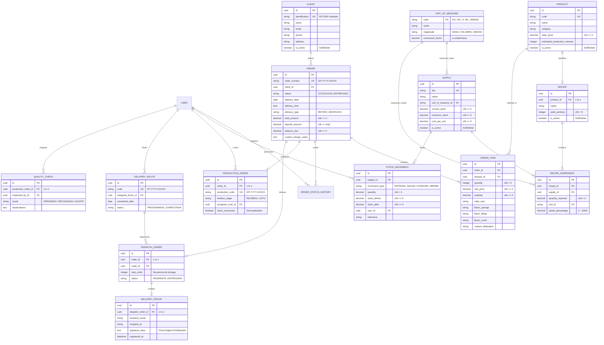

# Dulce Arte — Sistema de Gestión, Trazabilidad, Producción y Despacho

> **Evaluación Parcial N.º 3 — Desarrollo Backend**  
> Sistema web administrativo para pastelería artesanal desarrollado con arquitectura monolítica modular en Django, Django REST Framework y PostgreSQL.

---

## 1. Descripción del Proyecto

**Dulce Arte** es una plataforma web profesional concebida para digitalizar y optimizar la cadena de valor operativa de una pastelería artesanal de alta gama. El sistema abarca:

1. **Gestión Comercial:** Clientes, cotizaciones y pedidos personalizados con registro de especificaciones (bizcocho, relleno, cubierta, dedicatoria, tamaño).
2. **Inventario y Recetas (BOM):** Catálogo de insumos, unidades de medida con factores de conversión consistentes, stock mínimo, alertas tempranas y cálculo automático de ingredientes requeridos por receta con porcentaje de merma.
3. **Producción (Cocina):** Tablero interactivo Kanban con etapas operativas (*Recibido, En Preparación, Horneado/Decorado, Control de Calidad y Listo*).
4. **Descuento Transaccional de Stock:** Consumo de insumos con bloqueo de filas y bandera de protección anti-doble consumo (`stock_consumed`).
5. **Logística y Despacho:** Rutas de entrega (`DeliveryRoute`) con paradas ordenadas (`DispatchOrder`) y certificación de recepción mediante comprobante con firma digital (`DeliveryProof`).
6. **Seguridad y Auditoría:** Autenticación basada en sesiones, protección CSRF y control de acceso basado en roles (RBAC: `ADMIN`, `VENTAS`, `COCINA`, `REPARTIDOR`).

---

## 2. Stack Tecnológico

| Capa | Tecnología |
| :--- | :--- |
| **Lenguaje** | Python 3.12+ |
| **Framework Web** | Django 6.1.3 |
| **API REST** | Django REST Framework (DRF) 3.18.3 |
| **Base de Datos** | PostgreSQL 16 (con adaptador nativo `psycopg 3.3.8`) |
| **Frontend** | Django Templates + Tailwind CSS + JavaScript Vanilla / Canvas |
| **Seguridad** | Autenticación por Sesión Django + CSRF Protection + RBAC |
| **Despliegue Objetivo** | AWS Academy EC2 (Ubuntu Linux + Gunicorn + Nginx) |

---

## 3. Modelo Entidad-Relación (MER)



---

## 4. Integridad de Datos y Restricciones de Dominio

1. **Eliminación Lógica Protegida (`SoftDeleteModel`):**
   Las entidades con historial operativo (`Client`, `Supply`, `Product`, `Recipe`) implementan desactivación lógica preservando la integridad referencial.
2. **Restricción de No Negatividad a Nivel SQL (`CheckConstraint`):**
   * `chk_supply_stock_no_negativo`: `current_stock >= 0`.
   * `chk_supply_stock_min_no_negativo`: `minimum_stock >= 0`.
   * `chk_order_total_no_negativo`: `total_amount >= 0`.
   * `chk_order_abono_menor_o_igual_total`: `deposit_amount <= total_amount`.
   * `chk_ingredient_cantidad_positiva`: `quantity_required > 0`.
   * `chk_ingredient_merma_valida`: `waste_percentage >= 0 AND waste_percentage <= 100`.
3. **Conversión y Validación de Magnitudes Compatibles:**
   El modelo `RecipeIngredient` verifica en su método `clean()` que la unidad de medida utilizada coincida en tipo de magnitud con la unidad base del insumo (`MASA` con `MASA`, `VOLUMEN` con `VOLUMEN`), impidiendo inconsistencias físicas de recetas.
4. **Protección Referencial Estricta (`on_delete=models.PROTECT`):**
   Ningún cliente, insumo, producto o usuario con pedidos o movimientos históricos puede ser eliminado físicamente de la base de datos.
5. **Inmutabilidad de Auditoría:**
   Las tablas `StockMovement`, `OrderStatusHistory` y `DeliveryProof` son de solo lectura en la interfaz de administración, garantizando fidelidad auditable.

---

## 5. Instrucciones de Migración y Puesta en Marcha

### Migraciones versionadas
El repositorio incluye migraciones para los modelos del proyecto. La configuración local y la de producción usan PostgreSQL; aplica las migraciones a la base de datos definida en el archivo `.env` o en las variables de entorno:

```powershell
# 1. Crear entorno y activar
python -m venv .venv
.\.venv\Scripts\Activate.ps1

# 2. Instalar dependencias
pip install -r requirements.txt

# 3. Aplicar migraciones ordenadas
python manage.py migrate
```

Comprueba cuáles quedaron aplicadas en la base de datos de destino con:

```powershell
python manage.py showmigrations
```

Migraciones incluidas en el proyecto:
* `users.0001_initial`: Modelo de usuario personalizado con roles (`ADMIN`, `VENTAS`, `COCINA`, `REPARTIDOR`).
* `clients.0001_initial`: Tabla `clients_client` con validación de RUT/DNI y campos de auditoría.
* `inventory.0001_initial`: Tablas `inventory_unitofmeasure`, `inventory_supply`, `inventory_stockmovement` con restricciones de saldo no negativo.
* `recipes.0001_initial`: Tablas `recipes_product`, `recipes_recipe`, `recipes_recipeingredient` con validación de merma y unidades.
* `orders.0001_initial`: Tablas `orders_order`, `orders_orderitem`, `orders_orderstatushistory` con balance financiero.
* `production.0001_initial`: Tablas `production_productionorder`, `production_qualitycheck` con etapas Kanban y flag anti-duplicados.
* `dispatch.0001_initial`: Tablas `dispatch_deliveryroute`, `dispatch_dispatchorder`, `dispatch_deliveryproof` con paradas ordenadas y firma digital.

---

## 6. Personalización de Django Admin

Todos los modelos se encuentran registrados y optimizados en Django Admin ([http://127.0.0.1:8000/admin/](http://127.0.0.1:8000/admin/)):

* **Identidad Institucional:** Título e índice personalizados con "Dulce Arte — Administración".
* **Plantillas del Admin:** `templates/admin/base_site.html` adapta la marca y `templates/admin/index.html` enlaza al panel operativo.
* **Inlines Tabulares:**
  * `RecipeIngredientInline`: Configuración de ingredientes directamente dentro de cada receta.
  * `OrderItemInline`: Detalle y personalización de pasteles dentro de cada pedido.
  * `OrderStatusHistoryInline`: Historial inmutable de estados dentro del pedido.
  * `QualityCheckInline`: Control de calidad vinculado a la orden de producción.
  * `DispatchOrderInline`: Paradas de despacho dentro de cada ruta.
* **Indicadores Visuales de Estado (Badges):**
  * Estado comercial del pedido (Colores semánticos para Cotización, Confirmado, Producción, Listo, En Despacho, Entregado).
  * Alerta de stock crítico en insumos (`Stock Crítico` vs `Óptimo`).
  * Etapas del tablero Kanban de producción.
  * Certificación de entrega firmada.
* **Restricción de Edición:** `StockMovementAdmin`, `OrderStatusHistoryAdmin` y `DeliveryProofAdmin` tienen deshabilitadas las opciones de creación, edición y eliminación para impedir manipulación manual de registros históricos.

---

## 7. API REST y flujo operativo

La API se publica bajo `/api/v1/` y usa autenticación por sesión y permisos según rol. Incluye recursos para clientes, inventario, productos, recetas, pedidos, producción, despacho y métricas del dashboard.

El flujo principal queda cubierto de extremo a extremo: una cotización se confirma, genera una orden de producción, descuenta insumos una sola vez al iniciar cocina, exige control de calidad antes de quedar lista y certifica el despacho con una firma digital.

Las operaciones de API validan identificadores UUID, impiden paradas duplicadas en una ruta y permiten actualizar únicamente los campos comerciales de una cotización mientras siga en ese estado.

La interfaz web prioriza una navegación sencilla, métricas operativas, listados y enlaces a la administración. Las acciones de negocio siguen protegidas por los permisos existentes.

## 8. Ejecución de la Suite de Pruebas Automatizadas

El proyecto cuenta con 55 pruebas automatizadas que validan integridad relacional, reglas de negocio, restricciones de esquema, API REST, roles y el flujo operacional. La suite usa SQLite en memoria solo para pruebas; la configuración normal y la de producción siguen usando PostgreSQL. Las pruebas locales no sustituyen la comprobación de bloqueos y persistencia en PostgreSQL.

```powershell
python manage.py test tests --settings=config.settings.test
```

Resultado verificado localmente:
```text
Creating test database for alias 'default'...
.......................................................
----------------------------------------------------------------------
Ran 55 tests

OK
Destroying test database for alias 'default'...
```

### Casos de Prueba Cubiertos:
1. `test_database_connection`: Consulta `SELECT 1` sobre la base de pruebas.
2. `test_custom_user_roles`: Propiedades booleanas de roles de usuario.
3. `test_admin_login_page_status`: Accesibilidad de `/admin/login/`.
4. `test_web_login_page_status`: Formulario corporativo de login.
5. `test_dashboard_redirects_unauthenticated`: Protección de acceso anónimo.
6. `test_dashboard_accessible_when_authenticated`: Sesión activa en Dashboard.
7. `test_api_login_success`: Autenticación REST session login (HTTP 200).
8. `test_api_login_invalid_credentials`: Rechazo de credenciales inválidas (HTTP 401).
9. `test_client_creation_and_normalization`: Creación de cliente y formateo de RUT.
10. `test_client_duplicate_identification_fails`: Rechazo de RUT duplicado por `IntegrityError`.
11. `test_negative_stock_constraint`: Rechazo de stock negativo por `CheckConstraint`.
12. `test_incompatible_units_validation`: Rechazo de unidades de distinta magnitud en receta.
13. `test_invalid_quantity_constraint`: Rechazo de cantidad menor o igual a cero.
14. `test_recipe_ingredient_conversion_and_waste`: Cálculo de merma y conversión a unidad base.
15. `test_order_creation_with_multiple_items_and_balance`: Pedido con ítems y saldo pendiente.
16. `test_order_deposit_cannot_exceed_total`: Validación `deposit_amount <= total_amount`.
17. `test_protected_deletion_restrictions`: Bloqueo de eliminación física con `models.ProtectedError`.
18. `test_production_order_and_quality_check`: Vinculación One-to-One con pedido y control de calidad.
19. `test_delivery_route_and_dispatch_with_proof`: Ruta de despacho, parada y comprobante con firma.
20. `test_admin_site_accessibility`: Carga completa del panel administrativo con todos los modelos registrados.

## 9. Despliegue en AWS Academy EC2

**Estado:** desplegado en Ubuntu 26.04 con PostgreSQL 18, Gunicorn y Nginx. URL pública: [http://100.48.94.162/](http://100.48.94.162/). Se verificó una respuesta HTTP 200 para el inicio de sesión del Admin desde fuera de EC2.

### Preparar e iniciar la instancia

Usa una instancia Ubuntu con acceso SSH. En el grupo de seguridad permite SSH (puerto 22) solo desde tu IP y HTTP (puerto 80) desde Internet. El despliegue usa HTTP sobre la IP pública; no requiere dominio, DNS, HTTPS ni Certbot.

Coloca el proyecto en `/opt/dulce-arte` y ejecuta el instalador con la IP pública:

```bash
sudo bash /opt/dulce-arte/deploy/setup-ec2.sh 100.48.94.162
```

El script instala PostgreSQL, Nginx, Gunicorn y las dependencias; crea una base de datos y contraseñas aleatorias guardadas solo en `/etc/dulce-arte.env` (permisos `600`), configura `ALLOWED_HOSTS` y `CSRF_TRUSTED_ORIGINS` con `http://100.48.94.162`, ejecuta migraciones y recopila estáticos. `SECURE_SSL_REDIRECT`, `SESSION_COOKIE_SECURE` y `CSRF_COOKIE_SECURE` quedan en `False`, como corresponde al acceso HTTP solicitado.

Para acceso por SSH, copia el código excluyendo siempre `.env` y `.venv`; nunca subas claves ni secretos. Crea el usuario administrador en la instancia (el comando pedirá sus datos):

```bash
sudo bash -c 'set -a; source /etc/dulce-arte.env; set +a; cd /opt/dulce-arte; .venv/bin/python manage.py createsuperuser'
```

Verifica el servicio con `sudo systemctl status dulce-arte nginx postgresql` y abre `http://100.48.94.162/` y `http://100.48.94.162/admin/`. HTTP no cifra las credenciales ni protege las cookies en tránsito: úsalo solo para la demostración académica acordada.
# dulce-arte

# dulce-arte
